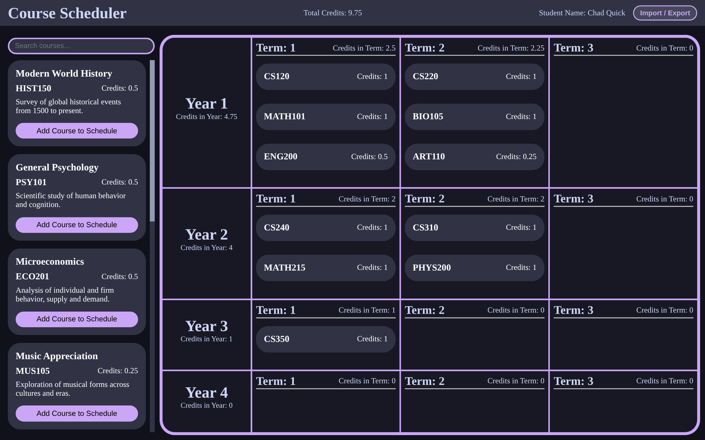
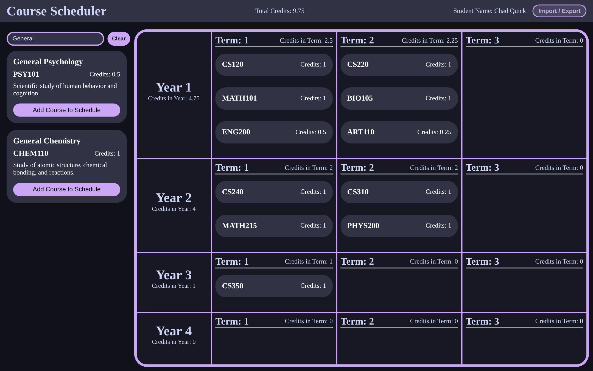
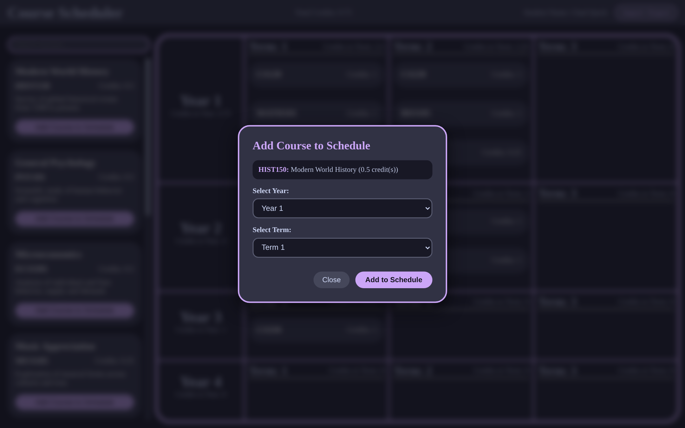
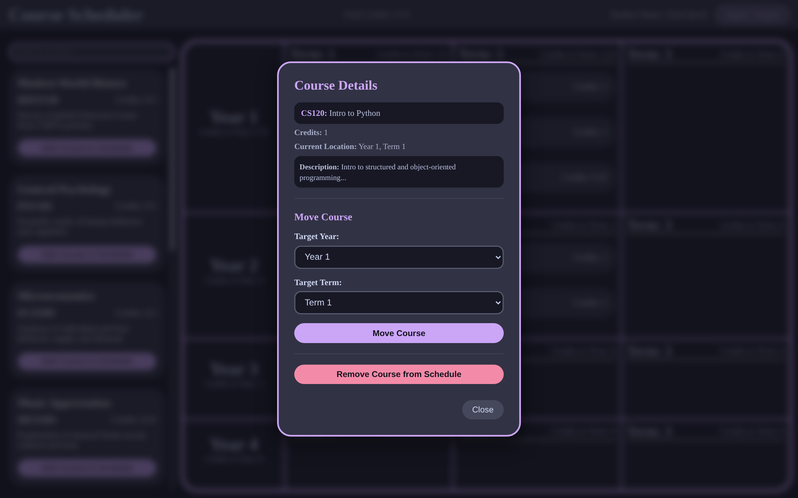
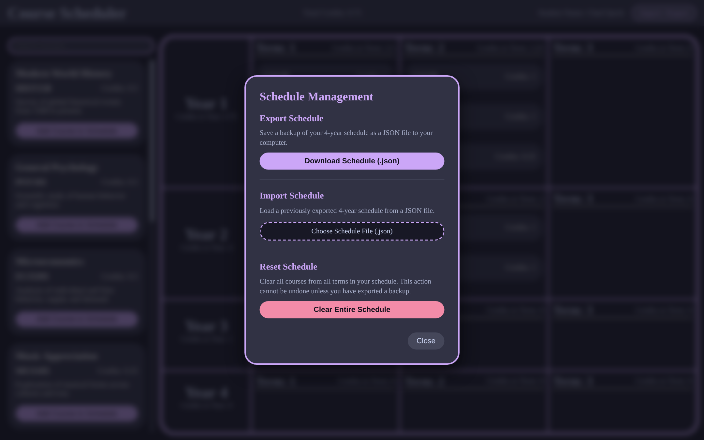

# CourseScheduler 🎓

CourseScheduler is an interactive, modern 4-year degree planner designed for college students to effortlessly organize, customize, and track their academic journey.

Built with a responsive Catppuccin Mocha theme, CourseScheduler provides a unified interface to browse available courses, place them across terms and academic years, monitor credit totals in real time, and export/import schedules for easy backup and sharing.

---

## 📸 Visual Tour

### 1. Main Dashboard & 4-Year Schedule
View your entire college trajectory across 4 academic years and 3 terms (Fall, Spring, Summer), with live total credit counts and the available courses catalog.



---

### 2. Live Course Search & Filtering
Search for courses by code or title in the sidebar. Courses already placed in your schedule are automatically filtered out to prevent duplicate placement.



---

### 3. Adding Courses to Schedule
Click **Add Course to Schedule** on any available course card to select your desired Year (1–4) and Term (1–3).



---

### 4. Managing, Moving, and Removing Courses
Click any placed course on your schedule grid to inspect course details, move it to another term or year, or delete it with an inline confirmation prompt.



---

### 5. Schedule Backups, Import & Reset
Open the **Import / Export** dialog from the top navigation bar to download a personalized JSON backup, restore a previous schedule with validation checks, or reset your planner to empty.



---

## ✨ Features

- **4-Year Term Grid:** 12 structured terms organized into 4 academic years (Terms 1, 2, and 3).
- **Dynamic Credit Tracker:** Automatic calculation of total credits across all placed courses.
- **Available Courses Catalog:** Backed by an SQLite database with instant course search and unplaced filtering.
- **Course Management:** Add courses into any term, move them between terms/years, or delete them with confirmation safeguards.
- **Persistent Local Storage:** Schedules automatically persist in browser `localStorage`, ensuring progress is never lost on refresh.
- **JSON Import / Export:** Download timestamped backups (e.g., `Chad_Quick_Schedule_YYYY-MM-DD.json`) and restore them anytime with overwrite verification.
- **Vercel Multi-Service Ready:** Configured with `vercel.json` to deploy both Vite frontend and Express backend as a unified project.

---

## 🚀 How to Use CourseScheduler

### 1. Adding a Course
1. Browse the **Available Courses** list in the left sidebar or use the search bar at the top of the sidebar.
2. Click the **Add Course to Schedule** button on the course card.
3. Choose your target **Year** (Year 1 to Year 4) and **Term** (Term 1, 2, or 3).
4. Click **Add Course** to place it on the board. The credit counter will update immediately.

### 2. Searching & Filtering Courses
- Type any course code (e.g., `CS`, `MATH`) or keyword (e.g., `Python`, `General`) into the search bar.
- Click **Clear** or delete the text to reset the filter.
- Courses placed anywhere on your schedule are automatically removed from the available sidebar. If you remove a course from your schedule, it instantly reappears in the sidebar.

### 3. Moving or Deleting a Course
1. Click directly on any course card in your schedule.
2. **To move:** Select the new target Year and Term under **Move Course**, then click **Move Course**.
3. **To delete:** Click **Delete Course**, then confirm by clicking **Yes, Remove Course**. The course will be removed from your schedule and returned to the available courses list.

### 4. Backing Up and Exporting
1. Click the **Import / Export** button next to the student name in the top navigation.
2. Under **Export Schedule**, click **Download Schedule (.json)**.
3. A clean JSON backup formatted with your name and date will be downloaded to your computer.

### 5. Importing a Saved Schedule
1. Open the **Import / Export** dialog.
2. Under **Import Schedule**, click **Choose Schedule File (.json)** and select your backup file.
3. Review the confirmation prompt showing the course count comparison.
4. Click **Yes, Replace Schedule** to load the schedule.

### 6. Resetting the Schedule
1. Open the **Import / Export** dialog.
2. Under **Reset Schedule**, click **Clear Entire Schedule**.
3. Confirm with **Yes, Clear Schedule** to clear all 4 years and start fresh.

---

## 🛠️ Project Structure

```text
CourseScheduler/
├── client/                     # Vite + React frontend
│   ├── src/
│   │   ├── components/         # React components (Year, Term, CourseCard, Dialogs)
│   │   ├── services/           # scheduleApi.js (API client)
│   │   ├── App.jsx             # Root application component & state management
│   │   ├── index.css           # Catppuccin Mocha styling
│   │   └── main.jsx            # Entry point
│   ├── vite.config.js          # Vite config with API dev proxy
│   └── package.json
├── server/                     # Express.js backend
│   ├── models/                 # Sequelize models (course.js)
│   ├── __tests__/              # Backend test suite (Jest)
│   ├── database.sqlite         # SQLite database file
│   ├── db.js                   # Sequelize connection & model initialization
│   ├── index.js                # Express app & API routes
│   ├── scheduleService.js      # Pure scheduling logic (add, remove, move)
│   ├── setup.js                # Database seeder script
│   └── package.json
├── docs/
│   └── screenshots/            # UI screenshots for documentation
├── vercel.json                 # Vercel multi-service deployment configuration
└── README.md
```

---

## 💻 Local Setup & Development

### Prerequisites
- [Node.js](https://nodejs.org/) (v18 or higher recommended)
- `npm` (comes with Node.js)

### 1. Clone the Repository
```bash
git clone https://github.com/wood20q/CourseScheduler.git
cd CourseScheduler
```

### 2. Set Up the Backend
```bash
cd server
npm install

# Seed the SQLite database with initial courses (if needed)
npm run setup

# Start the Express server (runs on port 3000)
npm start
```

### 3. Set Up the Frontend
In a new terminal window:
```bash
cd client
npm install

# Start the Vite development server (runs on port 5173)
npm run dev
```

Open your browser at `http://localhost:5173`. Any API calls to `/api` are automatically proxied to the backend at `http://localhost:3000`.

---

## 🧪 Running Tests

### Backend Tests (Jest)
```bash
cd server
npm test
```
Runs 40 comprehensive unit and integration tests covering scheduling immutability, error handling, edge cases, whitespace handling, and boundary checks.

### Frontend Build Verification
```bash
cd client
npm run build
```

---

## ☁️ Deployment (Vercel)

The repository includes a top-level `vercel.json` configured for Vercel's multi-service architecture:
- `client` service: Deployed as a Vite single-page application.
- `server` service: Deployed as an Express serverless API.
- Top-level rewrites route `/api/(.*)` to the backend service and `/(.*)` to the frontend.
