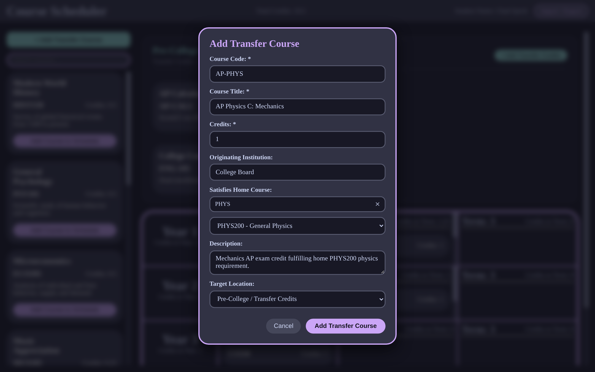
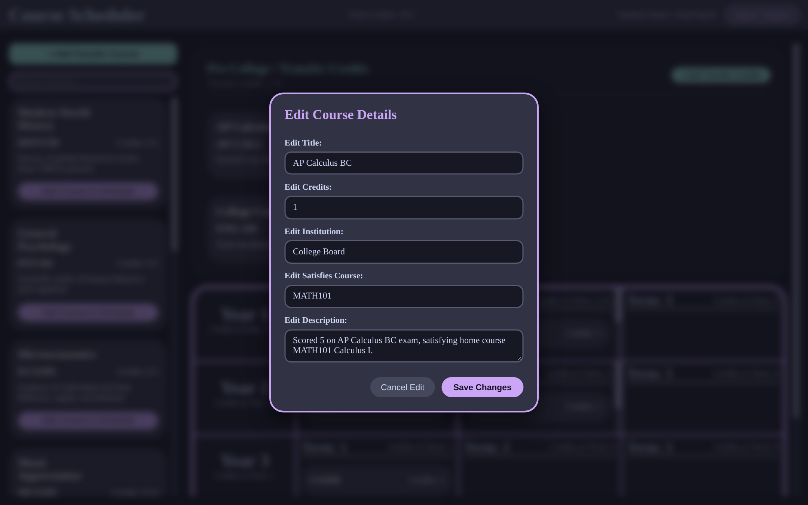
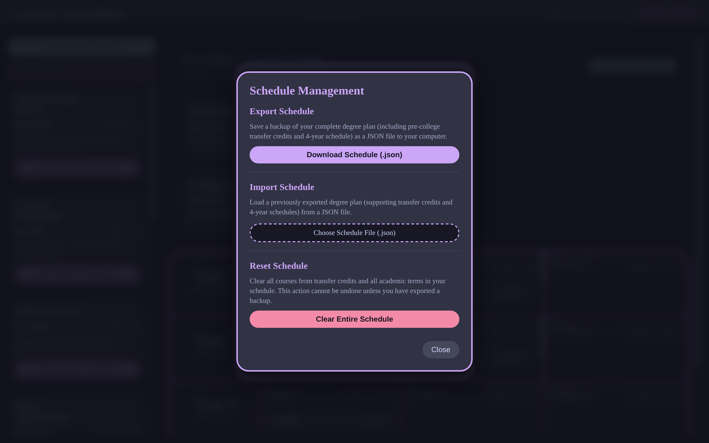

# CourseScheduler 🎓

CourseScheduler is an interactive, modern degree planner designed for university students to effortlessly organize, customize, and track their academic journey across pre-college transfer credits and four academic years.

Built with a responsive Catppuccin Mocha theme, CourseScheduler provides a unified interface to record transfer coursework, establish course equivalencies, browse available catalog courses, place classes across 12 academic terms, monitor fractional credit totals in real time, and export/import complete degree plans for safe archiving and sharing.

---

## 📸 Visual Tour

### 1. Main Dashboard & Degree Planner
View your complete academic trajectory—including a dedicated **Pre-College / Transfer Credits Section** above Year 1 and the 12-term 4-year grid—with live total credit calculations and an available catalog sidebar.


---

### 2. Live Course Search & Dynamic Equivalency Filtering
Search for courses by code or title. Courses already placed on the schedule—or fulfilled through transfer course equivalencies—are automatically filtered out to prevent duplicate enrollments.


---

### 3. Adding Catalog Courses to Terms
Click **Add Course to Schedule** on any available catalog course card to select your target Academic Year (1–4) and Term (1–3).


---

### 4. Adding Transfer Courses & Course Equivalency Articulation
Click **+ Add Transfer Course** to record external coursework (AP exams, dual enrollment, or college transfers). Enter Course Code, Title, Credits (with `0.25`, `0.5`, `0.75` fractional support), Originating Institution, Notes, and map it to an equivalent home Catalog Course via a searchable dropdown.



---

### 5. Managing & Inline Editing Placed Courses
Click any course card on your board to inspect full course details, move courses between the pre-college section and academic terms, or delete them with an explicit confirmation step (`Yes, Remove Course`). For transfer courses, click **Edit Details** to open the dedicated inline edit view and update titles, credits, institutions, descriptions, or satisfied courses.



---

### 6. Degree Plan Backups, Import & Reset
Open the **Import / Export** dialog to download a personalized JSON backup of your entire degree plan, restore previous plans with automatic backward compatibility for legacy 4x3 array exports, or reset your planner to empty.



---

## ✨ Features

- **Pre-College Transfer Credits Section:** Dedicated container positioned above Year 1 for AP exams, IB credits, and high school dual-enrollment coursework.
- **Course Equivalency Articulation:** Map transfer credits to specific home catalog courses, automatically fulfilling prerequisites and hiding satisfied courses from the catalog.
- **Fractional Credits Support:** Full precision for `0.25`, `0.5`, `0.75`, and whole credit values with exact floating-point rounding.
- **4-Year Term Grid:** 12 structured terms organized into 4 academic years (Terms 1, 2, and 3).
- **Dynamic Credit Tracker:** Real-time aggregation of total credits across both pre-college transfer credits and 4-year coursework.
- **Available Courses Catalog:** Backed by an SQLite database with instant live search and dynamic articulation filtering.
- **Complete Course Lifecycle Management:** Add, inspect, edit inline, move across any term or pre-college section, and remove courses with confirmation prompts.
- **Pure Client-Side Persistence:** Degree plans automatically persist in browser `localStorage`, ensuring progress is private and never lost across reloads.
- **Backward-Compatible JSON Import / Export:** Download timestamped backups (e.g., `Student_Schedule_YYYY-MM-DD.json`) with an automatic decoder that seamlessly upgrades legacy 4x3 array exports to the modern schema.
- **Catppuccin Mocha Dark Theme:** Elegant dark palette with rounded schedule corners, clear typography, and focused modal dialogs.
- **Vercel Multi-Service Ready:** Configured with `vercel.json` to deploy both Vite frontend and Express backend as a unified project.

---

## 🚀 How to Use CourseScheduler

### 1. Adding a Transfer Course
1. Click **+ Add Transfer Course** at the top of the Available Courses sidebar (or **+ Add Transfer Credits** in the empty Pre-College container).
2. Enter the **Course Code** (e.g., `AP-CALC`), **Course Title** (e.g., `AP Calculus BC`), and **Credits** (e.g., `1` or `0.75`).
3. *(Optional)* Enter the **Originating Institution** (e.g., `College Board`) and notes.
4. *(Optional)* In **Satisfies Home Course**, use the filter input to search for and select the equivalent catalog course (e.g., `MATH101`) or choose **Unlisted Course Code...** to enter a custom home course code.
5. Select the **Target Location** (defaults to *Pre-College / Transfer Credits*, or choose any academic year term).
6. Click **Add Transfer Course**. The course appears with a **Transfer** badge, updates total credits, and hides any satisfied catalog course from the available list.

### 2. Adding a Catalog Course
1. Browse the **Available Courses** list in the sidebar or use the search box.
2. Click **Add Course to Schedule** on the course card.
3. Choose your target **Year** (Year 1 to Year 4) and **Term** (Term 1, 2, or 3).
4. Click **Add Course**.

### 3. Inspecting, Editing, and Moving Courses
1. Click directly on any course card in your schedule to view **Course Details**.
2. **To edit details (Transfer Courses):** Click **Edit Details**, update the title, credits, institution, satisfied course, or notes, and click **Save Changes** (or **Cancel Edit**).
3. **To move:** Select the new target section (Pre-College or any Year/Term) under **Move Course**, then click **Move Course**.
4. **To delete:** Click **Remove Course from Schedule**, then confirm with **Yes, Remove Course**. Any previously satisfied catalog course is immediately restored to the available courses list.

### 4. Backing Up and Exporting
1. Click the **Import / Export** button in the top navigation bar.
2. Under **Export Schedule**, click **Download Schedule (.json)**.
3. A clean JSON backup containing both your transfer credits and 4-year schedule will download to your computer.

### 5. Importing a Saved Plan
1. Open the **Import / Export** dialog.
2. Under **Import Schedule**, click **Choose Schedule File (.json)** and select your backup file (both new object schemas and legacy 4x3 array files are automatically validated and decoded).
3. Review the confirmation prompt showing the course count comparison.
4. Click **Yes, Replace Schedule** to load the schedule.

### 6. Resetting the Schedule
1. Open the **Import / Export** dialog.
2. Under **Reset Schedule**, click **Clear Entire Schedule**.
3. Confirm with **Yes, Clear Schedule** to reset both transfer credits and all academic terms to an empty state.

---

## 🛠️ Project Structure

```text
CourseScheduler/
├── client/                     # Vite + React frontend
│   ├── src/
│   │   ├── components/         # React components
│   │   │   ├── AddCourseDialog.jsx
│   │   │   ├── AddTransferCourseDialog.jsx
│   │   │   ├── AvailableCourses.jsx
│   │   │   ├── CourseCard.jsx
│   │   │   ├── ImportExportDialog.jsx
│   │   │   ├── ManageCourseDialog.jsx
│   │   │   ├── Term.jsx
│   │   │   ├── TransferCreditsSection.jsx
│   │   │   └── Year.jsx
│   │   ├── services/           # scheduleApi.js (API client)
│   │   ├── utils/              # scheduleMigration.js (schema decoder, locations & credits)
│   │   ├── __tests__/          # Frontend test suite (Vitest + React Testing Library)
│   │   ├── App.jsx             # Root application component & state management
│   │   ├── index.css           # Catppuccin Mocha styling
│   │   └── main.jsx            # Entry point
│   ├── vite.config.js          # Vite config with API dev proxy
│   └── package.json
├── server/                     # Express.js backend
│   ├── models/                 # Sequelize models (course.js)
│   ├── __tests__/              # Backend test suite (Jest + Supertest)
│   ├── database.sqlite         # SQLite database file
│   ├── db.js                   # Sequelize connection & model initialization
│   ├── index.js                # Express app & API routes
│   ├── initialCourses.js       # Default catalog course seed data
│   ├── scheduleService.js      # Pure scheduling logic (add, remove, move)
│   ├── setup.js                # Database seeder script
│   └── package.json
├── docs/
│   ├── adr/                    # Architecture Decision Records
│   ├── agents/                 # Agent guidelines and tracker configurations
│   └── screenshots/            # UI screenshots for documentation
├── scripts/
│   └── take_screenshots.js     # Headless Chromium screenshot automation
├── AGENTS.md                   # Agent system instructions
├── GLOSSARY.md                 # Ubiquitous domain language & terminology
├── vercel.json                 # Vercel multi-service deployment configuration
└── README.md
```

---

## 💻 Local Setup & Development

### Prerequisites
- [Node.js](https://nodejs.org/) (v18, v20, or v22 recommended)
- `npm` (comes with Node.js)

### 1. Clone the Repository
```bash
git clone https://github.com/wood20q/CourseScheduler.git
cd CourseScheduler
```

### 2. Set Up the Backend
```bash
cd server
npm install

# Seed the SQLite database with initial courses (if needed)
npm run setup

# Start the Express server (runs on port 3000)
npm start
```

### 3. Set Up the Frontend
In a new terminal window:
```bash
cd client
npm install

# Start the Vite development server (runs on port 5173)
npm run dev
```

Open your browser at `http://localhost:5173`. Any API calls to `/api` are automatically proxied to the backend at `http://localhost:3000`.

---

## 🧪 Running Tests

### Frontend Tests (Vitest & React Testing Library)
```bash
cd client
npm test
```
Runs 36 comprehensive tests across 5 test suites covering schedule migration, transfer course addition, course equivalency articulation, dynamic catalog filtering, inline editing, moving, deletion, and fractional credit handling.

### Backend Tests (Jest & Supertest)
```bash
cd server
npm test
```
Runs 49 comprehensive unit and integration tests covering scheduling immutability, schema compatibility, error handling, edge cases, whitespace handling, and boundary checks.

### Code Quality & Build Verification
```bash
# Frontend linter
cd client && npm run lint

# Frontend production build
cd client && npm run build
```

---

## 📷 Generating Screenshots

To re-generate all UI documentation screenshots:
```bash
# Build the client first
cd client && npm run build

# Run the screenshot automation script from the repository root
cd ..
node scripts/take_screenshots.js
```
The script boots the local services, drives a headless Chromium browser through each application flow, and outputs high-resolution screenshots to `docs/screenshots/`.

---

## ☁️ Deployment (Vercel)

The repository includes a top-level `vercel.json` configured for Vercel's multi-service architecture:
- `client` service: Deployed as a Vite single-page application.
- `server` service: Deployed as an Express serverless API.
- Top-level rewrites route `/api/(.*)` to the backend service and `/(.*)` to the frontend.
